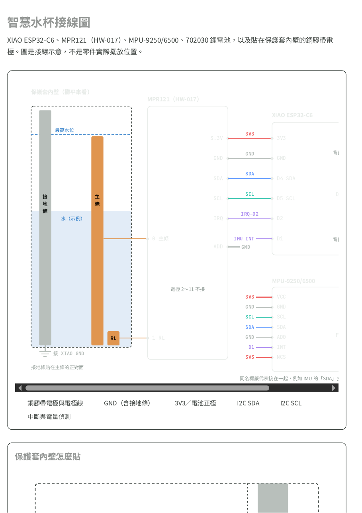
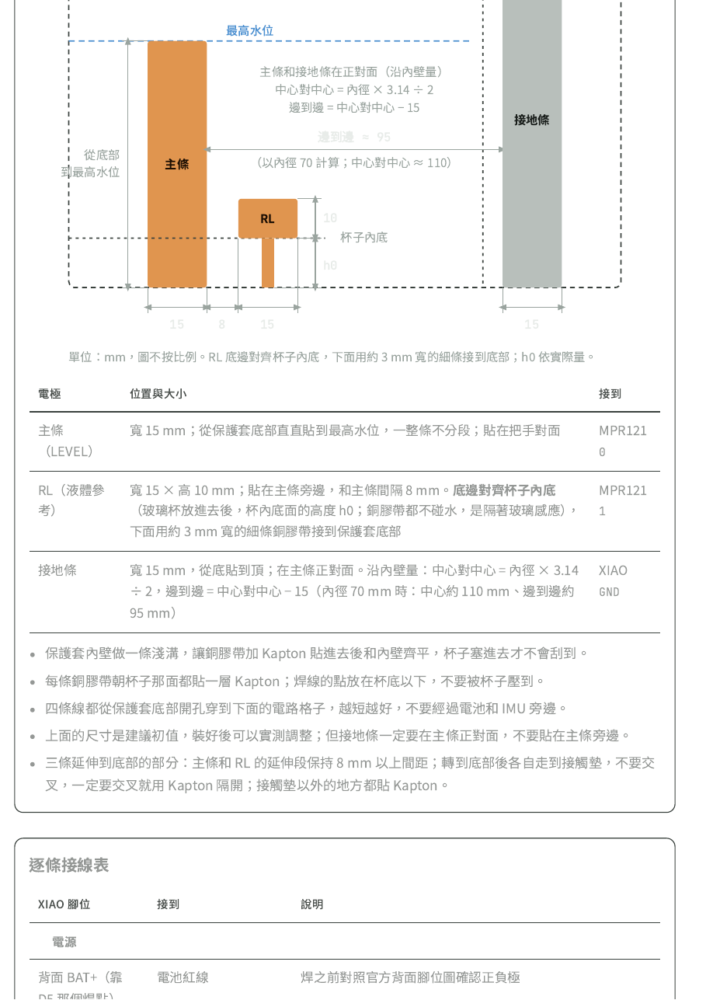

# smart_cup_firmware

智慧水杯韌體。用貼在保護套內壁的銅膠帶電極，隔著玻璃杯量測水位。

目前的程式是**硬體接線測試加即時水位顯示**：開機時自動檢查每個模組的接線，接著每 0.5 秒印一行電極讀值、水位 %、加速度和電池電壓。BLE、深度睡眠還沒做。

| 項目 | 內容 |
|---|---|
| 主板 | Seeed Studio XIAO ESP32-C6（4MB Flash，USB-C = USB Serial/JTAG） |
| 電容感測 | MPR121（HW-017 模組），I2C `0x5A` |
| IMU | MPU-9250 / MPU-6500，I2C `0x68` |
| 電池 | 702030 鋰電池，焊在 XIAO 背面 BAT+／BAT− |
| 開發環境 | ESP-IDF **v6.1** |

---

## 用法總覽

**韌體只有一個版本**，沒有另外的「校正版」。校正就是用同一份韌體量出空杯、滿杯的讀值，把兩個數字寫進程式，再燒錄一次。

| 你要做的事 | 怎麼做 | 要改程式嗎 |
|---|---|---|
| **平常使用**：看水位 | 燒錄一次，之後開 monitor 看「水位%」欄。見[第 3 節](#3-燒錄) | 不用 |
| **校正**：第一次組裝、換杯子、重貼電極之後 | 量空杯、滿杯 → 改 `main/main.c` 的兩個數字 → 重新燒錄。見[第 4 節](#4-水位校正) | 改兩個 `#define` |

```
                 ┌──────────── 校正（只在需要時做）─────────────┐
                 │                                              │
燒錄韌體 ──► 量空杯讀值 ──► 量滿杯讀值 ──► 改 LEVEL_E0_EMPTY ──► 重新燒錄 ──► 平常使用：看「水位%」
                                            LEVEL_E0_FULL
```

目前的校正值（空杯 403、滿杯 298）是 2026-11-19 用現在這個杯子和電極量的。杯子、電極都沒換的話，**直接燒錄就能用，不必再校正**。

---

## 1. 接線

完整接線圖、電極尺寸和接線順序都在 **[docs/wiring.pdf](docs/wiring.pdf)**。





> PDF 第 1 頁的接線圖右側被切掉了，XIAO 背面腳位和電池那一段看不到。以下面的接線表為準。

| XIAO 腳位 | 接到 | 說明 |
|---|---|---|
| 3V3 | MPR121 3.3V、IMU VCC、IMU NCS | 用電池供電時 5V 腳位沒電，全部接 3V3 |
| GND | MPR121 GND、MPR121 ADD、IMU GND、IMU AD0、**接地條** | ADD、AD0 接地 → 位址固定為 0x5A、0x68 |
| D4（GPIO22） | MPR121 SDA、IMU SDA | I2C SDA（共用） |
| D5（GPIO23） | MPR121 SCL、IMU SCL | I2C SCL（共用） |
| D1（GPIO1） | IMU INT | 高電位有效；之後用來從深度睡眠喚醒 |
| D2（GPIO2） | MPR121 IRQ | 低電位有效、開汲極（程式會開內部上拉） |
| D0（GPIO0） | 電池分壓中點 | BAT+ → 200kΩ → D0 → 200kΩ → GND，讀值 ×2 = 電池電壓 |
| 背面 BAT+／BAT− | 電池紅線／黑線 | 焊之前用三用電表確認正負極 |

| MPR121 電極 | 銅膠帶 | 位置 |
|---|---|---|
| 0 | **主條**（LEVEL） | 寬 15 mm，從保護套底部貼到最高水位，貼在把手對面 |
| 1 | **RL**（液體參考） | 寬 15 × 高 10 mm，在主條旁邊、間隔 8 mm，底邊對齊杯子內底 |
| —（接 XIAO GND） | **接地條** | 寬 15 mm，從底貼到頂，貼在主條**正對面** |

銅膠帶朝杯子那一面都要貼 Kapton，電極不碰水，是隔著玻璃感應。

---

## 2. 開發環境

ESP-IDF v6.1 由 EIM 安裝在 `~/.espressif/v6.1/esp-idf`。`idf.py` 預設不在 PATH，**每開一個新的終端機都要先執行**：

```bash
source ~/.espressif/tools/activate_idf_v6.1.sh
```

用 VS Code 的話，要開**本專案的資料夾**，不要開上一層。開錯的話，狀態列的建置、燒錄按鈕會在錯的目錄執行，出現「沒有 CMakeLists.txt」或「找不到 sdkconfig」的錯誤。

---

## 3. 燒錄

### 第一次（剛 clone 下來）

`sdkconfig` 沒有放進 git，第一次要先指定晶片，ESP-IDF 會依 `sdkconfig.defaults` 產生設定：

```bash
source ~/.espressif/tools/activate_idf_v6.1.sh
idf.py set-target esp32c6
```

### 編譯、燒錄、看輸出

用 USB-C 線接上 XIAO，序列埠通常是 `/dev/ttyACM0`：

```bash
source ~/.espressif/tools/activate_idf_v6.1.sh
idf.py build
idf.py -p /dev/ttyACM0 flash monitor
```

- 離開 monitor：`Ctrl+]`
- 在 monitor 裡重開機、重跑開機測試：`Ctrl+T` 再按 `Ctrl+R`
- 燒錄失敗、找不到板子時：按住 XIAO 的 **BOOT** 鍵，再按一下 **RESET**，放開 BOOT，就會進入下載模式，然後重新燒錄。燒完按一次 RESET。

### 開機後會看到什麼

1. 等 3 秒，讓 USB 重新連線。
2. 自動跑 6 項測試，印出總結表：I2C 掃描、MPR121、IMU、IMU INT、電池、MPR121 IRQ。失敗的項目會列出要檢查哪幾條線。
3. 進入即時顯示，每 0.5 秒一行：

```
 時間(s) 電極0 電極1  水位%   觸碰 IRQ數 | 加速X(g) 加速Y(g) 加速Z(g) 合計(g) 傾斜(度) | 電池(V)
     4.7   337   522     63     無     0 |   +0.059   -0.017   +1.005   1.007      3.5 |    0.55
```

| 欄位 | 意思 |
|---|---|
| 電極0 | 主條的讀值（0～1023）。**水越多，數字越小** |
| 電極1 | RL 的讀值。只有水位很低時變化大，目前只顯示、不參與計算 |
| 水位% | 由電極0 換算，見下一節 |
| 觸碰 | MPR121 內建的觸碰判斷。**不能拿來判斷水位**：開機時當下的值會被當成基準線 |

**只插 USB、沒接電池時**，電池欄會顯示 0.5～0.9 V，總結表裡電池那項判定失敗。這是正常現象：BAT+ 沒接東西，讀到的是殘留電荷慢慢放掉的電壓。

---

## 4. 水位校正

### 原理

MPR121 讀到的是電極充電後的電壓。水越多，主條的電容越大，讀值就越小。實測主條讀值跟水位高度接近直線關係，所以用**空杯、滿杯兩點**做直線換算：

```
水位% = (空杯值 − 電極0) / (空杯值 − 滿杯值) × 100     （超出 0～100 的部分截掉）
```

### 校正程式碼

都在 [main/main.c](main/main.c)：

```c
// MPR121 0x5D：充電時間 1 µs（預設 0.5 µs）。讀值和水位變化量約放大一倍，雜訊不變
#define MPR121_CONFIG2_RUN      0x44

// 水位校正值：電極0 在空杯、滿杯時的讀值
#define LEVEL_E0_EMPTY          403
#define LEVEL_E0_FULL           298

static float water_level_pct(uint16_t e0)
{
    float pct = (float)(LEVEL_E0_EMPTY - (int)e0) * 100.0f / (float)(LEVEL_E0_EMPTY - LEVEL_E0_FULL);
    if (pct < 0.0f) {
        pct = 0.0f;
    } else if (pct > 100.0f) {
        pct = 100.0f;
    }
    return pct;
}
```

### 什麼時候要重新校正

- 第一次組裝好
- 換了杯子或保護套
- 重貼、改動銅膠帶或電極線
- 改了 MPR121 的充電電流（0x5C）或充電時間（0x5D）

以上都沒發生的話，不用校正，直接用[第 3 節](#3-燒錄)燒錄就好。

### 校正步驟

用的是同一份韌體，不用另外燒「校正版」。量的時候手不要碰杯子或保護套：手的電容比水位變化大很多，讀數會亂跳。

**步驟 1：燒錄韌體**（板子上已經是這份韌體的話，可以跳過）

```bash
source ~/.espressif/tools/activate_idf_v6.1.sh
idf.py -p /dev/ttyACM0 flash
```

**步驟 2：量空杯**

杯子放進保護套、**不裝水**、杯壁擦乾，手離開杯子，然後執行：

```bash
python tools/read_levels.py
```

如果開著 `idf.py monitor`，要先按 `Ctrl+]` 關掉。同一個序列埠一次只能給一個程式讀。

錄 15 秒後，最後幾行會像這樣。記下 **「電極0 平均」**，這裡是 403.3：

```
有效筆數 15
電極0 平均 403.3（402～404）
電極1 平均 541.5（541～542）
水位% 平均 6.8（6～8）
```

最後一行的水位% 是用舊校正值算的，校正時不用管。

**步驟 3：量滿杯**

倒水到**最高水位**，手離開杯子，再執行一次 `python tools/read_levels.py`，記下「電極0 平均」，例如 298.0。

**步驟 4：把數字寫進程式**

打開 [main/main.c](main/main.c)，搜尋 `LEVEL_E0_EMPTY`，把兩個數字改成步驟 2、3 量到的值，四捨五入成整數：

```c
#define LEVEL_E0_EMPTY          403     // 空杯時電極0 的讀值   ← 步驟 2
#define LEVEL_E0_FULL           298     // 滿杯時電極0 的讀值   ← 步驟 3
```

**步驟 5：重新燒錄並驗證**

```bash
idf.py -p /dev/ttyACM0 flash monitor
```

`flash` 會自動重新編譯，不用另外執行 `idf.py build`。燒完看「水位%」欄：空杯應顯示約 0%，滿杯約 100%。完成後這份韌體就是正式使用的版本。

#### 關於 tools/read_levels.py

- 預設讀 `/dev/ttyACM0`、錄 15 秒。可以用 `-p` 改序列埠、用 `-s` 改秒數，例如 `python tools/read_levels.py -p /dev/ttyACM1 -s 20`。
- 打開序列埠時板子會重開機，跑完開機測試大約要 5 秒，所以秒數不要少於 10 秒。重開機前的舊資料，腳本會自動丟掉。
- 要在 ESP-IDF 的 Python 環境執行（先 `source` 過 activate 腳本），裡面已經有 pyserial。
- 不想用腳本的話，開 monitor 直接看「電極0」欄，抓個大概的平均值也可以。

### 目前的校正數據（2026-11-19）

| 狀態 | 電極0（0.5 µs） | 電極0（1 µs，目前設定） | 電極1（1 µs） | 顯示水位 |
|---|---|---|---|---|
| 空杯 | 205 | **403**（±1） | 541 | 0% |
| 目測半杯 | 177.5 | 337.5～345.5 | 521～522 | 55%～63% |
| 滿杯 | 153 | **298**（±3） | 519 | 100% |

- 空杯到滿杯總共變化約 105，雜訊約 ±2，所以解析度大約是 2%。
- 目測半杯顯示 55%～63%，原因還沒確認：可能是杯子上寬下窄，也可能是倒水不準。電極量的是**水的高度**，不是容量。需要更準時，用尺量水深來比對，或加入半杯當第三個校正點，改成兩段直線換算。

### 還沒做

- [docs/wiring.pdf](docs/wiring.pdf) 建議的 TI TIDA-00317 算法：用 RL 當液體參考，算 `水位 = RL 高度 × (主條 − 空杯主條) ÷ (RL − 空杯 RL)`，可以抵銷水質、溫度造成的變化。目前只用主條兩點校正。
- 只在杯子放下、靜止、直立時量水位，用 IMU 判斷。
- 空杯值的自動重新校正：杯子移動、環境改變時，空杯讀值會漂移約 10。

---

## 5. 專案結構

```
main/main.c          接線測試 + 即時顯示 + 水位換算
main/CMakeLists.txt  用到的 ESP-IDF 元件（esp_driver_i2c、esp_driver_gpio、esp_adc、esp_timer）
sdkconfig.defaults   主控台走 USB Serial/JTAG、4MB Flash
tools/read_levels.py 校正用：錄一段電極讀值並算平均
docs/wiring.pdf      接線圖、電極尺寸、接線順序
HANDOFF.md           開發交接筆記（ESP-IDF v6 注意事項、已踩過的坑）
```
